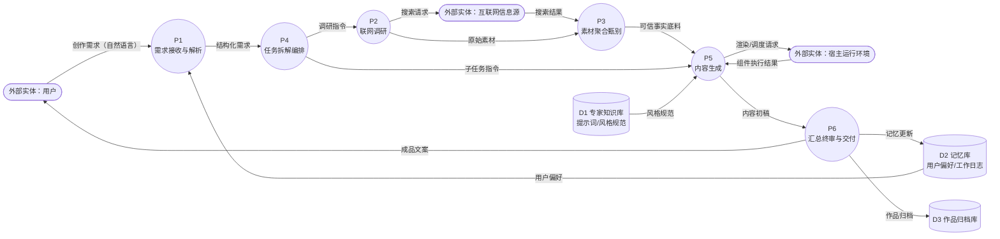

# 《信息系统分析与设计》数据流分析作业

## 分析对象：WorkBuddy「内容创作专家」（Content Creator）

> 分析依据：两次真实调用实测。  
> 测试用例 1：输入需求「写一篇小红书 AI 工具种草文案」→ 联网调研 → 生成文案 → 渲染数据流图；  
> 测试用例 2：输入「将产品长文同时改写为抖音短视频脚本与微博短文案」→ 任务拆解 → 双子代理并行生成 → 汇总交付。

---

## 一、七个启发问题的结构化分析

### 问题 1：系统作为信息处理器完成什么功能？最重要的输入与输出？

**核心功能**：将用户的自然语言创作需求，加工为符合特定平台风格规范（小红书、公众号、抖音、微博等）的可发布内容成品。系统的本质是一个「需求 → 内容」的信息转换器。

| 项目    | 内容                                                                                     |
| ----- | -------------------------------------------------------------------------------------- |
| 最重要输入 | ① 用户创作需求（自然语言指令，如"写一篇小红书种草文案"）；② 外部调研信息（搜索引擎返回的工具热度、平台爆款结构等原始素材）；③ 长期记忆数据（用户偏好、历史工作日志） |
| 最重要输出 | ① 平台适配的成品文案（标题 + 正文 + emoji 排版 + 标签/分镜脚本）；② 过程性产物（数据流图等可视化交付物）；③ 记忆更新（工作日志、归档记录）       |

### 问题 2：系统与外界环境的关系

系统边界内外包含四类外部实体：

- **用户（需求源/成品接收方）**：既是原始需求的发起者，也是最终成品的唯一验收方，构成"输入—输出"闭环的两端。
- **互联网信息源（信息供给方）**：搜索引擎与公开网页，为系统提供实时事实底料，弥补模型知识时效性不足。
- **宿主平台运行环境（能力供给方）**：WorkBuddy 提供子代理调度、并行执行、可视化渲染、文件读写等基础设施，系统通过调用这些服务完成加工动作。
- **目标发布平台（风格约束方，非直接交互方）**：小红书/抖音/微博并不与系统直接交互，而是以"平台风格规范"的形式内化为系统的处理规则（如 140 字限制、前 3 秒钩子、违禁词合规）。

### 问题 3：系统可分解为哪些子系统/子功能？

依据实测调用链，系统可分解为 **6 个相对独立又有联系的加工（处理过程）**：

1. **P1 需求接收与解析**：接收自然语言需求，结合用户记忆识别意图与约束；
2. **P2 联网调研（信息采集）**：构造搜索查询，从互联网获取实时信息；
3. **P3 素材聚合与甄别**：对搜索结果去重、核实、提取可用事实底料；
4. **P4 任务拆解与编排**：判断任务复杂度，决定单管线处理或拆解为多个并行子任务；
5. **P5 内容生成**：按平台风格规范产出内容初稿（可派发多个子代理并行）；
6. **P6 汇总终审与交付**：合并多版本初稿，统一调性、合规质检、交付成品并归档。

测试用例 1 走的是 `P1→P2→P3→P5→P6` 单管线；测试用例 2 走的是 `P1→P4→P5(×2并行)→P6` 拆解并行管线——两条实测路径验证了 P4 编排器的分派能力。

### 问题 4：子功能是否还能继续细分？

可以，二级分解（以最复杂的两个加工为例）：

- **P2 联网调研** → 查询构造（将需求翻译为检索词）、并行检索（多路搜索同时发起）、结果去噪（剔除失效/低质来源）；
- **P5 内容生成** → 选题定位（受众与卖点取舍）、结构编排（套用平台爆款结构）、风格迁移（口语化、去 AI 味）、合规检查（违禁词、AI 内容标注要求）；
- **P6 汇总终审** → 多版本合并、调性一致性校验、事实复核、成品格式化。

### 问题 5：每个子功能的输入与输出数据

| 加工         | 输入数据              | 输出数据             |
| ---------- | ----------------- | ---------------- |
| P1 需求接收与解析 | 用户自然语言需求、用户偏好记忆   | 结构化需求（意图、平台、约束）  |
| P2 联网调研    | 调研指令（由结构化需求派生）    | 原始搜索结果（多路网页摘要）   |
| P3 素材聚合甄别  | 原始搜索结果            | 可信事实底料（去重核实后的素材） |
| P4 任务拆解编排  | 结构化需求             | 子任务指令集（含并行分派策略）  |
| P5 内容生成    | 子任务指令/事实底料、专家风格规范 | 内容初稿（单份或多份并行）    |
| P6 汇总终审与交付 | 内容初稿              | 成品文案、记忆更新、归档记录   |

### 问题 6：需要长期保存的数据及其创建、修改、使用方式

| 数据存储      | 内容               | 创建         | 修改                      | 使用                 |
| --------- | ---------------- | ---------- | ----------------------- | ------------------ |
| D1 专家知识库  | 专家提示词、平台风格规范、技能包 | 插件安装时由市场下发 | 由插件版本升级更新（会话内只读）        | P5 生成时读取，作为风格与流程规则 |
| D2 记忆库    | 用户偏好档案、工作区日志     | 首次交互时创建    | 每次任务完成后追加/更新（追加式日志，不覆盖） | P1 解析需求时读取以个性化处理   |
| D3 作品与归档库 | 历史成品、过程产物        | P6 终审通过后归档 | 一般只追加                   | 复盘、跨会话延续、内容复用      |

### 问题 7：数据从来源到去处是否完整？

逐条链路检查（以测试用例 2 为例）：

1. 需求源：用户发出"一源双产"需求 → 经 P1 解析 → P4 拆解 → P5 并行生成 → P6 终审 → **回到用户手中（闭环）**；
2. 信息源：互联网搜索结果 → P3 甄别 → 进入 P5 作为事实底料 → 最终体现在成品中 → 归档至 D3（有去处）；
3. 系统自身数据：P6 产生的工作日志 → 写入 D2 记忆库（有去处），D2 数据在下次会话被 P1 读取（有来源）——存储的读/写两端皆闭环；
4. 异常路径也有出口：源文缺失时，系统自拟演示稿并在交付时显式标注假设，数据流不悬空。

**结论：数据流的源与汇完整，无悬空数据流。**

---

## 二、数据流图（DFD，Mermaid 代码）

---

## 三、结构解释

本图为**一层分解数据流图（Level-1 DFD）**，把「内容创作专家」这个黑盒系统打开为六个加工，遵守"父图与子图数据流平衡"的原则——进入系统的仍是用户需求，流出系统的仍是成品文案。

**图的四类元素：**

1. **外部实体（圆角卡片，共 3 个）**：用户、互联网信息源、宿主运行环境。它们在系统边界之外，只发送或接收数据，不被系统加工。
2. **加工/处理过程（圆形，P1–P6）**：系统的六个子功能，是全部信息变换动作的发生地。数据流经加工时发生形态改变（如"自然语言需求"经 P1 变为"结构化需求"）。
3. **数据存储（圆柱形，D1–D3）**：专家知识库（只读规则源）、记忆库（随任务动态追加）、作品归档库（终态沉淀）。存储是读写汇聚点，使系统的行为可以跨会话延续。
4. **数据流（带标签的箭头）**：每条箭头都标注了具体的数据名而非控制信号，这是 DFD 区别于程序流程图的关键。

**两条主干数据流路径：**

- **调研驱动路径**（对应测试用例 1）：用户需求 → P1 → P4 → P2 → 互联网 → P3 → P5 → P6 → 用户。它体现了系统"先取证、后创作"的信息加工逻辑；
- **拆解并行路径**（对应测试用例 2）：P4 将一个输入扇出为多路子任务指令，P5 内部并行加工后由 P6 汇合终审。扇出—汇合结构是本系统处理复合任务的核心机制。

**存储的闭环设计**：D2 记忆库存在双向数据流（P1 读、P6 写），说明系统具备状态记忆；D1 是纯读取源，代表系统的专业规则相对稳定；D3 是纯写入汇，代表成品的沉淀归档。

---

## 四、文字解析

> 本作业以 WorkBuddy 平台的「内容创作专家」为分析对象，运用数据流分析方法对其进行了结构化建模。该系统本质上是一个"需求—内容"信息转换器：以用户的自然语言创作需求为主要输入，以符合特定平台风格规范的成品文案为主要输出。分析中，系统被划分为需求接收与解析、联网调研、素材聚合甄别、任务拆解编排、内容生成、汇总终审与交付六个加工，并通过两次真实调用（单管线调研驱动型、拆解并行型）验证了分解的合理性。图中用户、互联网信息源与宿主运行环境为三个外部实体，界定了系统的边界；专家知识库、记忆库与作品归档库三个数据存储支撑了系统的规则复用、状态延续与成果沉淀。数据流层面，从需求发起到成品交付，再经记忆更新与归档写回存储，各条数据流均有明确的源与汇，满足数据流图的完整性要求。其中"任务拆解编排"加工的扇出—汇合结构，是系统实现一源多产、并行生成的核心机制，也体现了信息系统中"编排层"对复杂业务流程的抽象价值。

---

*分析人：咸鱼 · 2026-11-06*
